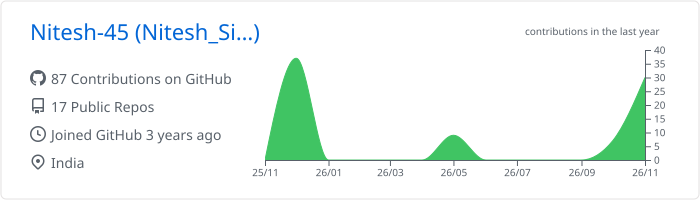
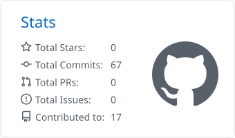
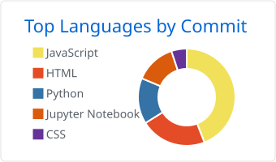
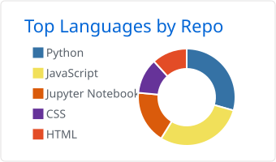

<h1>Hi, I'm Nitesh Singh Mehra 👋</h1>

 

  

---

## 👨‍💻 About Me

- 🔭 Currently building **[AI-RealTime-GYM-Coach](https://github.com/Nitesh-45/AI-RealTime-GYM-Coach)**
- 🌱 Currently learning **Agentic AI**
- 📝 I write articles on [explaintechwithnitesh.blogspot.com](https://explaintechwithnitesh.blogspot.com/)
- 💬 Ask me about **AI/ML, LLMs, RAG and Agentic AI**
- 📫 Reach me at **niteshsinghmehra17@gmail.com**
- ⚡ Fun fact: a neural network is inspired by the human brain, but it doesn't work exactly like one.

---

## 🚀 Featured Projects

<!-- EDIT: check each description and tech list so they match your repos exactly -->

| Project | What it does | Tech |
|---|---|---|
| **[AI-RealTime-GYM-Coach](https://github.com/Nitesh-45/AI-RealTime-GYM-Coach)** | Real-time AI coaching for gym workouts using the webcam | Python · OpenCV |
| **[AI-Resume-ATS-Score-Checker](https://github.com/Nitesh-45/AI-Resume-ATS-Score-Checker)** | Scores a resume against a job description, ATS-style | Python · NLP · Flask |
| **[Neural-Art](https://github.com/Nitesh-45/Neural-Art)** | Neural-network-based image / art generation | Python · Deep Learning |

---

## 🛠️ Tech Stack

**Languages** 

**AI / ML / Data** 

**Backend / DevOps / Databases** 

---

## 📊 GitHub Analytics

<picture>
  <source media="(prefers-color-scheme: dark)" srcset="https://raw.githubusercontent.com/Nitesh-45/Nitesh-45/main/profile-summary-card-output/github_dark/0-profile-details.svg" />
  
</picture>
<picture>
  <source media="(prefers-color-scheme: dark)" srcset="https://raw.githubusercontent.com/Nitesh-45/Nitesh-45/main/profile-summary-card-output/github_dark/3-stats.svg" />
  
</picture>

<picture>
  <source media="(prefers-color-scheme: dark)" srcset="https://raw.githubusercontent.com/Nitesh-45/Nitesh-45/main/profile-summary-card-output/github_dark/2-most-commit-language.svg" />
  
</picture>
<picture>
  <source media="(prefers-color-scheme: dark)" srcset="https://raw.githubusercontent.com/Nitesh-45/Nitesh-45/main/profile-summary-card-output/github_dark/1-repos-per-language.svg" />
  
</picture>

 

### 🔥 Contribution Streak

<picture>
  <source media="(prefers-color-scheme: dark)" srcset="https://streak-stats.demolab.com?user=Nitesh-45&theme=dark&hide_border=true" />
  
</picture>

### 🐍 Contribution Graph

<picture>
  <source media="(prefers-color-scheme: dark)" srcset="https://raw.githubusercontent.com/Nitesh-45/Nitesh-45/output/github-snake-dark.svg" />
  
</picture>

---

⭐ If you find something useful here, a star on a repo is always appreciated.

